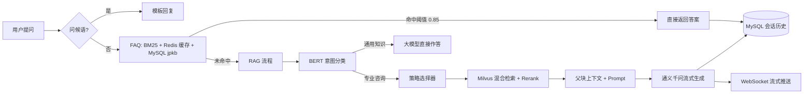

# 集成式智能问答系统（FAQ + RAG）

面向 IT 教育场景的智能问答服务。用户提问后，系统先用 **FAQ 模块**（MySQL + Redis + BM25）匹配高频问答对；匹配不到再进入 **RAG 模块**（Milvus 混合检索 + 重排序 + 检索策略选择 + 大模型生成），答案通过 WebSocket 流式返回，并在 MySQL 中保存最近 5 轮会话历史。

## 功能特性

- **两级问答**：FAQ 精确/相似匹配优先，未命中自动回落到 RAG，兼顾速度与知识覆盖。
- **混合检索**：BGE-M3 稠密向量 + 稀疏向量联合检索，BGE-Reranker 重排序，返回父块作为上下文。
- **自适应检索策略**：由大模型判断使用「直接检索 / 假设问题检索 / 回溯问题检索 / 子查询检索」。
- **意图识别**：微调 `bert-base-chinese` 二分类器，区分「通用知识」与「专业咨询」，通用问题直接交给大模型回答。
- **父子块切分**：文档先切父块（1200 字）再切子块（300 字），命中子块后回溯父块上下文。
- **多格式文档加载**：支持 txt / md / doc / docx / ppt / pptx / jpg / png / pdf，PDF、图片、Office 走 OCR 加载器。
- **多轮对话**：按 `session_id` 在 MySQL `conversations` 表保存最近 5 轮历史；清除历史使用逻辑删除（`_is_deleted`）。
- **流式输出**：FastAPI WebSocket 逐 token 推送，带 `start / token / end / error` 事件。
- **效果评估**：使用 RAGAS 计算忠实度、答案相关性、上下文相关性、上下文召回率。

## 系统架构



## 目录结构

```text
.
├── app.py                        # FastAPI 服务入口：HTTP 接口 + WebSocket 流式接口
├── new_main.py                   # IntegratedQASystem：FAQ / RAG 串联、会话历史管理
├── base/
│   ├── config.py                 # 配置加载：环境变量 > config.ini > 默认值
│   └── logger.py                 # 全局日志
├── mysql_qa/                     # FAQ 模块
│   ├── db/mysql_client.py        # MySQL 连接、jpkb 建表、CSV 导入、问答查询
│   ├── cache/redis_client.py     # Redis 缓存（问题列表、问答对）
│   ├── retreival/bm25_search.py  # BM25 相似度检索与阈值判断
│   ├── utils/preprocess.py       # 中文分词与预处理
│   ├── data/JP学科知识问答.csv    # 高频问答数据（约 2000 条）
│   └── main.py                   # FAQ 命令行调试入口
├── rag_qa/                       # RAG 模块
│   ├── core/
│   │   ├── rag_system.py         # RAG 主流程、四种检索策略、生成回答
│   │   ├── query_classifier.py   # BERT 意图分类与训练
│   │   ├── strategy_selector.py  # 检索策略选择
│   │   ├── vector_store.py       # Milvus 集合管理、混合检索、重排序
│   │   ├── document_processor.py # 文档加载与父子块切分
│   │   └── prompts.py            # 各阶段 Prompt 模板
│   ├── edu_document_loaders/     # PDF / 图片 / DOC / PPT / MD 加载器
│   ├── edu_text_spliter/         # 中文递归切分器、按模型切分器
│   ├── models/                   # 模型目录（见「模型与数据」）
│   └── rag_assesment/            # RAGAS 评测脚本与数据集
├── config.ini.example            # 配置模板（密钥用占位文字，复制为 config.ini 使用）
├── Dockerfile / docker-compose.yml
├── requirements.txt
└── .gitignore / .gitattributes   # 排除敏感信息与大文件；BERT 模型走 Git LFS
```

## 快速开始

### 1. 环境准备

- Python 3.10（Docker 镜像基于 `python:3.10.18-slim`）
- 外部服务：MySQL、Redis、Milvus；大模型使用阿里云 DashScope 兼容接口

```bash
pip install -r requirements.txt
cp config.ini.example config.ini   # Windows 用 copy
```

在 `config.ini` 中填写数据库/Redis 密码和 `DASHSCOPE_API_KEY`；**更推荐用环境变量**，避免密钥落盘：

```bash
export DASHSCOPE_API_KEY="你的api key"     # Windows PowerShell: $env:DASHSCOPE_API_KEY="你的api key"
export MYSQL_PASSWORD="你的数据库密码"
export REDIS_PASSWORD="你的Redis密码"
```

> 仓库中不包含 `config.ini` 和 `.env`，只有脱敏模板。代码中的默认值是中文占位文字，未填写时无法连接相应服务。

### 2. 初始化 FAQ 数据

MySQL 数据库（默认 `subjects_kg`）需要建 `jpkb` 表并导入问答 CSV：

```bash
python -c "from mysql_qa.db.mysql_client import MysqlClient; c=MysqlClient(); c.create_table(); c.insert_csv('mysql_qa/data/JP学科知识问答.csv')"
```

系统首次启动时会自动把问题从 MySQL 同步到 Redis 并构建 BM25 索引。

### 3. 初始化 RAG 文档库

把资料按 `{学科名}_data` 命名放到目录（如 `rag_qa/data/ai_data`），然后切块入库：

```bash
python -c "from rag_qa.core.document_processor import process_documents; from rag_qa.core.vector_store import VectorStore; VectorStore().add_documents(process_documents('rag_qa/data/ai_data'))"
```

`VectorStore` 会自动创建/加载 Milvus 集合（默认 `edurag_xian_1`），包含稠密向量、稀疏向量、父块内容、学科等字段。原始文档目录 `rag_qa/data/ai_data/` 未随仓库提交。

### 4. 启动服务

```bash
python app.py                 # 默认监听 0.0.0.0:8080，可用 HOST / PORT 环境变量覆盖
```

Docker 方式：

```bash
docker compose up --build
```

> `docker-compose.yml` 只包含应用服务，MySQL / Redis / Milvus 需要自行准备并让其可通过配置中的地址访问。前端静态文件放到 `static/` 目录（该目录被 `.gitignore` 排除），根路径 `/` 会返回 `static/index.html`。

## API 接口

| 方法 | 路径 | 说明 |
|------|------|------|
| GET | `/` | 返回 `static/index.html` 前端页面 |
| GET | `/health` | 健康检查，返回 `{"status": "healthy"}` |
| POST | `/api/create_session` | 创建会话，返回 `session_id` |
| GET | `/api/sources` | 获取有效学科列表（默认 ai / java / test / ops / bigdata） |
| POST | `/api/query` | 非流式查询；FAQ 命中直接返回答案，未命中时提示改用 WebSocket |
| GET | `/api/history/{session_id}` | 查询最近 5 轮会话历史 |
| DELETE | `/api/history/{session_id}` | 逻辑清除会话历史 |
| WS | `/api/stream` | 流式查询，逐 token 推送答案 |

非流式请求体：

```json
{ "query": "Python 课程大纲是什么？", "subject_filter": "python", "session_id": "可选" }
```

WebSocket 连接后发送：

```json
{ "query": "比较 Milvus 和 Faiss 的优缺点", "source_filter": null, "session_id": "可选" }
```

服务端事件格式：

```json
{"type": "start", "session_id": "..."}
{"type": "token", "token": "逐字输出的内容", "session_id": "..."}
{"type": "end", "is_complete": true, "processing_time": 1.23, "session_id": "..."}
{"type": "error", "error": "错误信息"}
```

## 配置说明

`base/config.py` 的优先级为：**环境变量 > `config.ini` > 内置默认值**。

| 分类 | 配置项 | 默认值 / 说明 |
|------|--------|---------------|
| MySQL | `MYSQL_HOST` / `MYSQL_USER` / `MYSQL_PASSWORD` / `MYSQL_DATABASE` | `localhost` / `edu_rag` / 占位文字 / `subjects_kg` |
| Redis | `REDIS_HOST` / `REDIS_PORT` / `REDIS_PASSWORD` / `REDIS_DB` | `localhost` / `6379` / 占位文字 / `0` |
| Milvus | `MILVUS_HOST` / `MILVUS_PORT` / `MILVUS_DATABASE_NAME` / `MILVUS_COLLECTION_NAME` | `localhost` / `19530` / `itcast` / `edurag_xian_1` |
| 大模型 | `DASHSCOPE_API_KEY` | 必须填写；`model`、`dashscope_base_url` 在 `config.ini` 的 `[llm]` 段配置 |
| 检索 | `[retrieval]` 段 | 父块 1200、子块 300、重叠 50、召回 5、最终候选 2 |
| 应用 | `[app]` 段 | 学科列表、客服电话；`HOST` / `PORT` 由 `app.py` 从环境变量读取 |

## 模型与数据

- `rag_qa/models/bert-base-chinese/`：项目保留的唯一模型，约 412MB，通过 **Git LFS** 跟踪，用于意图分类和切分器。
- 以下模型体积过大，未提交到仓库，运行 RAG 前需自行下载到 `rag_qa/models/` 对应目录：
  - `bge-m3`：稠密 + 稀疏向量嵌入
  - `bge-reranker-large`：重排序
  - `bert_query_classifier`：微调后的意图分类器（缺失时会基于 BERT 初始化新模型）
- `rag_qa/rag_assesment/rag_evaluate_data.json`（30 条）与 `_small.json`（5 条）为评测集。

评测方式（脚本按相对路径读取数据，需在评测目录下执行）：

```bash
cd rag_qa/rag_assesment
python ragas_evaluate.py
```

## 已知问题

1. `new_main.py` 第 11 行引用 `rag_qa.core.new_rag_system.RAGSystem`，但仓库中只有 `rag_qa/core/rag_system.py`（类名为 `RagSystem`，构造参数和方法签名也不同）。直接启动 API 前需要补齐该模块或改为调用现有实现。
2. `docker-compose.yml` 中 Milvus 主机变量写成了 `MILVUS_FFJZ`，应为 `MILVUS_HOST`。
3. 部分模块的 `__main__` 示例中使用了原作者本机的绝对路径，自行调试时需替换为本地路径。
4. `app.py` 的 CORS 配置为 `allow_origins=["*"]`，生产环境应限制来源。
5. 高频问答的匹配阈值为 `0.85`，可在 `app.py` / `new_main.py` 的 `faq.search(..., threshold=...)` 中调整。
